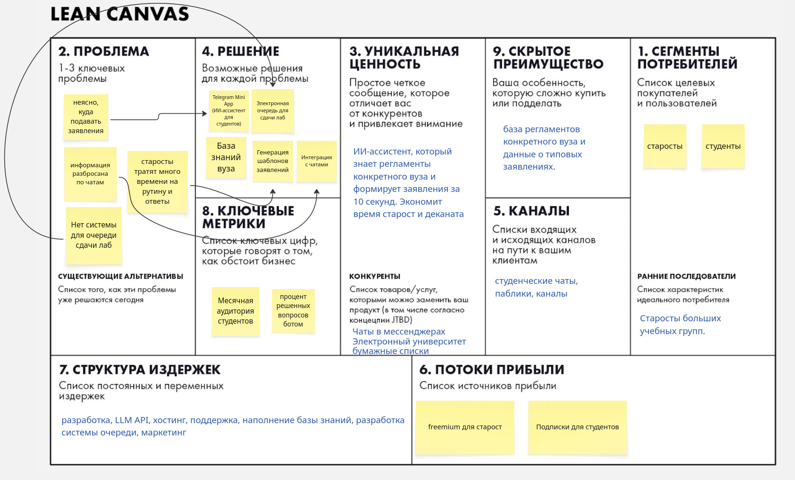
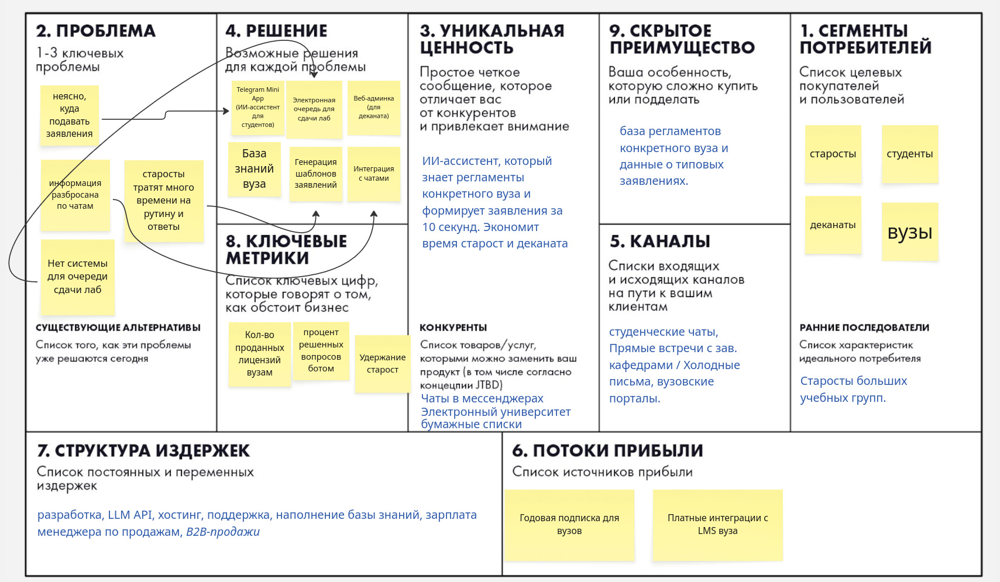

# ДЗ 1. Идея и Lean Canvas

**Идея:** Web-платформа с AI-ассистентом и Telegram Mini App для старост.
**Бизнес-модель (до пивота):** B2C (продажа премиум-подписок студентам).

## Elevator Pitch
Старосты тратят часы на объяснения, куда и как подавать заявления. Мы делаем веб-платформу с AI-ассистентом в Telegram Mini App: студент пишет вопрос -- получает точную инструкцию и готовый шаблон заявления. В отличие от общих чатов и ChatGPT, ассистент знает правила конкретного вуза и экономит время старост.

## Lean Canvas (Изначальная версия)

---

# ДЗ 2. Product Discovery

## 1. HADI-гипотеза
Самый критичный риск из моего Lean Canvas -- **Риск ценности (Value Risk)**. Если студентам и старостам будет сложно или непривычно пользоваться платформой, они вернутся в обычные чаты.

*   **(H) Гипотеза:** Я верю, что старосты и студенты готовы перейти в веб-платформу/Mini App, если она реально экономит время и снижает стресс при подаче заявлений.
*   **(A) Действие (MVP):** 
    1. Проведу 10-15 интервью со старостами (спрошу про их реальную боль).
    2. Сделаю фейк-лендинг с кнопкой «Хочу это в свою группу» и запущу рекламу на 5000 руб. в студенческих пабликах.
*   **(D) Данные:** Замерю % старост, у которых подтвердилась боль (> 80%), и конверсию из клика в заявку на лендинге (> 10%).
*   **(I) Выводы:** Если цифры сойдутся -- боль реальна, перехожу к Консьерж-MVP (ручной обработке заявок). Если нет -- меняю концепцию.

## 2. Юнит-экономика (базовый расчет)
Посчитал экономику для изначальной B2C-модели (если бы продавали подписку самим студентам).
*   **CAC:** Клик в рекламе -- 150 руб. Конверсия в регистрацию -- 50%, конверсия в активного юзера -- 25%. Итого: `150 / 0.5 / 0.25 = 1200 руб.` за одного платящего пользователя.
*   **LTV:** Подписка 100 руб./мес. При частоте использования (2 лабы в неделю + заявления) чистая прибыль с одного клиента за всё время (с учетом оттока) -- примерно 200 руб.
*   **Сходимость:** `LTV / CAC = 200 / 1200 = 0.16`. 
*   **Вывод:** Экономика не сходится. Золотое правило (LTV > 3*CAC) не выполняется. Если привлекать студентов за деньги, мы просто сгорим.

## 3. План Б (Pivot)
Так как на бумаге B2C-модель не сработала (LTV < CAC), я применяю два типа Пивота:

1. **Business Architecture Pivot (Смена бизнес-модели):** 
   Изначально в ДЗ1 я планировал продавать подписки самим студентам (B2C). Но из-за дорогого привлечения мы уходим в B2B2C: теперь платформу покупают **вузы и деканаты** (чек -- 50 000 руб./год за факультет). Вузу это выгодно, так как разгружает сотрудников. Студенты получают доступ бесплатно.
   
2. **Channel Pivot (Смена драйвера роста / канала):**
   Отказываемся от платной рекламы (которая давала CAC 1200 руб.). Вместо этого используем виральность: староста создает очередь на лабу в Mini App и кидает ссылку в чат группы. Все студенты переходят по ссылке, регистрируются, а мы получаем CAC близкий к нулю. Электронная очередь становится нашим главным виральным инструментом.

## Обновленный Lean Canvas (После Пивота)

---

# ДЗ 3. Требования

## 1. User Stories
**Роли:**
* студент
* староста
* сотрудник деканата

**User stories**
*   Как **студент**, я хочу задать вопрос боту в Telegram и получить точную инструкцию, чтобы не искать информацию в закрепленных сообщениях чата.
*   Как **староста**, я хочу сгенерировать готовый шаблон заявления по нужной теме, чтобы не тратить время на перепечатывание старых бланков.
*   Как **студент**, я хочу записаться в электронную очередь на сдачу лабораторной, чтобы не стоять под дверью и не пропускать другие пары.
*   Как **сотрудник деканата**, я хочу загружать новые регламенты в админку, чтобы ИИ-бот отвечал на основе актуальных правил (а не галлюцинировал).
*   Как **сотрудник деканата**, я хочу видеть статистику частых вопросов, чтобы понимать, какие инструкции нужно улучшить.

## 2. MVP и MLP
*   **MVP:** Telegram-бот на Python (aiogram) + база данных (SQLite). ИИ работает через API с заранее загруженным PDF-файлом правил. Простая очередь. Веб-админки нет, базу обновляю вручную.
*   **MLP:** Полноценный Telegram Mini App. Веб-админка для деканата, где они сами загружают документы и смотрят дашборд с аналитикой. Push-уведомления о подходе очереди. Интеграция с чатами.

## 3. Функциональные требования (ФТ)
*   **Авторизация:** Автоматический вход через Telegram-аккаунт.
*   **Генерация:** Бот принимает текст на естественном языке и выдает ответ с готовым шаблоном заявления.
*   **Очередь:** Староста создает группу, студенты занимают/освобождают места.
*   **Админка:** Загрузка PDF/DOCX для базы знаний и выгрузка аналитики по запросам.
*   **Уведомления:** Пуш за 15 минут до подхода очереди.

## 4. Нефункциональные требования (НФТ)
*   **Производительность:** Генерация ответа ИИ -- не более 5 секунд.
*   **Надежность:** Uptime не менее 99%. Сервер должен держать пиковую нагрузку в сессию в 500+ одновременных юзеров.
*   **Безопасность:** HTTPS. Персональные данные.
*   **Юзабилити:** Интерфейс Mini App под мобилки, крупные кнопки. Быстрый отклик на нажатие.
*   **Масштабируемость:** Возможность быстро добавить новый факультет в БД без переписывания бэкенда.
## 5. Приоритизация функционала (по методу MoSCoW)

Для формирования бэклога и понимания объема MVP я приоритизировал весь функционал платформы.

**M (Must have - обязательно в MVP):**
*   Авторизация через Telegram-аккаунт;
*   База знаний (загрузка PDF с правилами вуза);
*   ИИ-генерация шаблонов заявлений по текстовому запросу;
*   Электронная очередь на сдачу лаб (как виральный инструмент);
*   Базовая админка для загрузки файлов (без сложной аналитики).

**S (Should have - важно, делаем во вторую очередь):**
*   Telegram Mini App с красивым пользовательским интерфейсом (вместо обычных сообщений);
*   Push-уведомления о подходе очереди за 15 минут;
*   Дашборд аналитики для деканата (статистика частых вопросов);
*   Интеграция с чатами групп (автоматическая рассылка ссылок на очередь).

**C (Could have - можно сделать, если останется время/бюджет):**
*   Интеграция с LMS вуза (Moodle и др.);
*   Геймификация для студентов (ачивки за сданные вовремя лабы);
*   Голосовой ввод запроса для ИИ-ассистента.

**W (Won't have - не делаем в этой версии):**
*   Нативные мобильные приложения (iOS/Android) -- используем кроссплатформенность Telegram;
*   Полноценная замена «Электронного университета» (расписание, зачетки);
*   Социальная сеть для студентов внутри приложения;
*   Оплата подписки самими студентами (так как мы ушли от B2C-модели).
